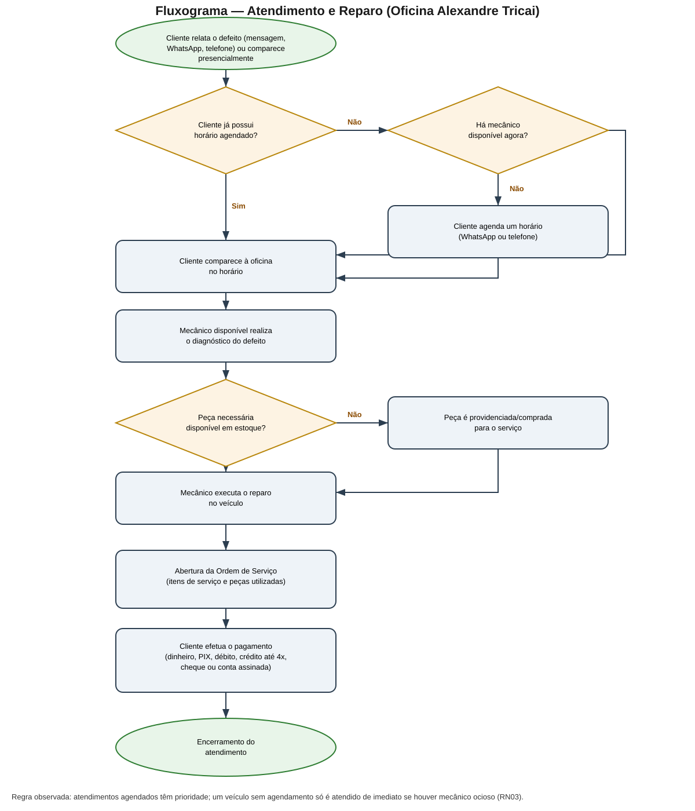
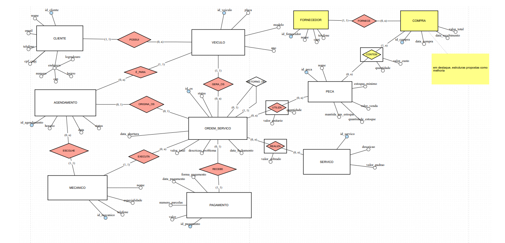
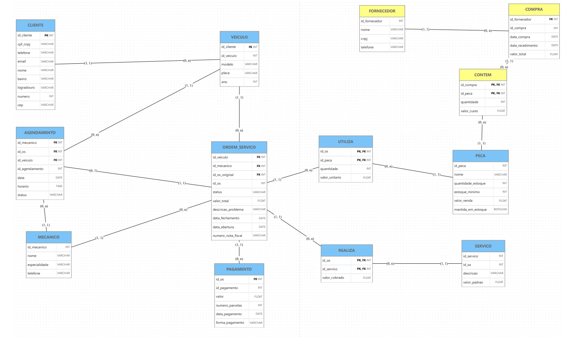

# Oficina Mecânica Alexandre Tricai — Modelagem de Banco de Dados

**Entrega 2 — Do modelo ao banco** · MBD 2026-2 · Terça Noite · Grupo 1

## Integrantes

| Nome completo | RGM | Usuário no GitHub |
|---|---|---|
| Caio Santos Alencar | 47052830 | CaioAlencar7711 |
| Gabriel Tricai  | 47142014 | [PREENCHER] |
| Italo Guilherme  | 47189771 | [PREENCHER] |
| Ezequiel Soares | 47205521 | [PREENCHER] |
| Davi de Souza | 47169826 | [PREENCHER] |

## Ferramentas e artefatos

| Item | Onde |
|---|---|
| Software de modelagem (DER e lógico) | brModelo Web — [conceitual](https://app.brmodeloweb.com/conceptual/6ada69d9db66b4314c898c05) e [lógico](https://app.brmodeloweb.com/logic/6aee671423e97e414aac78e5) |
| SGBD | MySQL 8 |
| DER conceitual revisado | [`diagramas/der-oficina-tricai.png`](diagramas/der-oficina-tricai.png) |
| Modelo lógico | [`diagramas/modelo-logico-oficina-tricai.png`](diagramas/modelo-logico-oficina-tricai.png) |
| Dicionário de dados | [`dicionario-dados.html`](dicionario-dados.html) |
| Levantamento | [`levantamento.md`](levantamento.md) |
| Script SQL e massa de dados | [`docs/`](docs/) [PREENCHER nome do arquivo `.sql`] |

---

## 1. Relatório Técnico Final

### 1.1 Revisão do Modelo Conceitual

#### Introdução
A Oficina Mecânica Alexandre Tricai é uma oficina de pequeno porte em Suzano-SP, especializada na manutenção de vans Mercedes-Benz (linha Sprinter CDI), atendendo principalmente empresas de transporte de passageiros e fretamento. A oficina não usa nenhum sistema de informação: o cadastro de clientes é refeito a cada ordem de serviço em talão de papel, o estoque de peças é controlado apenas pela organização física nas prateleiras (sem registro de quantidades), os agendamentos são combinados por WhatsApp ou telefone e as compras de peças não são registradas formalmente.

**Objetivo:** implementar o banco de dados completo que sustenta a operação da oficina, partindo do modelo conceitual revisado da Entrega 1, passando pelo modelo lógico normalizado, até o script SQL em MySQL com consultas gerenciais e de auditoria.

#### Caracterização da Organização

- **Nome e natureza:** Alexandre Tricai - Oficina Mecânica Especializada, empresa com fins lucrativos, CNPJ 14.855.257/0001-30.
- **Vínculo do grupo:** Gabriel Tricai, integrante do grupo, é filho de Alexandre Tricai, proprietário da oficina. Esse vínculo familiar facilitou o contato com o responsável pelo estabelecimento e a realização da entrevista para o levantamento de informações.
- **Porte (números):**
  - Pessoas: 4 a 5 envolvidas (proprietário e mecânicos), sem registro em sistema de RH.
  - Atendimentos: aproximadamente 20 por semana.
  - Clientes ativos: aproximadamente 50.
  - Veículos atendidos: aproximadamente 70 por mês.
  - Peças mantidas em estoque: aproximadamente 40.
  - Fornecedor principal: Rodobens.
Os números foram informados por Gabriel Tricai, com base nas informações fornecidas por Alexandre Tricai, proprietário da oficina. Como o estabelecimento não possui controle sistematizado desses indicadores, os valores são tratados como estimativas.
- **Escopo:** todos os dados da operação da oficina: clientes, veículos, mecânicos, agendamentos, ordens de serviço, serviços, peças, compras, fornecedores, pagamentos e notas fiscais.
- **Responsável que atendeu o grupo:** Alexandre Tricai, proprietário da oficina. Telefone: (11) 99778-1502.

**Problemas identificados e como o modelo os resolve**


| Código | Problema | Resolvido por |
|---|---|---|
| P1 | Cadastro de clientes e veículos realizado em papel a cada ordem de serviço, dificultando a organização das informações. | CLIENTE, VEICULO |
| P2 | Dificuldade para consultar o histórico de manutenções realizadas em clientes e veículos. | VEICULO, ORDEM_SERVICO, REALIZA, UTILIZA |
| P3 | Controle visual do estoque, sem registro sistematizado das quantidades e das peças utilizadas em cada serviço. | PECA, UTILIZA, CONTEM |
| P4 | Agendamentos realizados por WhatsApp ou telefone, sem registro centralizado, podendo gerar conflitos de horários. | AGENDAMENTO, MECANICO |
| P5 | Compras de peças realizadas conforme a necessidade, sem registro formal das compras e dos fornecedores no sistema. | FORNECEDOR, COMPRA, CONTEM |
| P6 | Necessidade de vincular os retornos de veículos às ordens de serviço originais, facilitando o acompanhamento dos serviços anteriores. | ORDEM_SERVICO (autorre relacionamento por id_os_original) |


**Evidências**

- Endereço: Av. Miguel Badra, 782 — Cidade Boa Vista, Suzano/SP. Contato: (11) 99778-1502 e (11) 4752-6266.
- **Comprovação da existência da oficina:** [Oficina Mecânica Alexandre Tricai — Google Maps](https://maps.app.goo.gl/aE3fp3jGJKC6SqfDA)
- Foto do modelo físico de Ordem de Serviço: [`evidencias/ordem-servico-modelo.jpg`](evidencias/ordem-servico-modelo.jpg)
- Foto do letreiro externo: [`evidencias/fachada-letreiro.jpg`](evidencias/fachada-letreiro.jpg)
- Foto da visita do grupo com o proprietário: [`evidencias/equipe-oficina.jpg`](evidencias/equipe-oficina.jpg)
- Foto do estoque de peças: [`evidencias/estoque-pecas.jpg`](evidencias/estoque-pecas.jpg)
- Foto do galpão com veículos em manutenção: [`evidencias/galpao-vans-clientes.jpg`](evidencias/galpao-vans-clientes.jpg)

   #### Levantamento de Informações

Texto completo em [`levantamento.md`](levantamento.md). Resumo:

- **Entrevista:** realizada por Gabriel Tricai com Alexandre Tricai, responsável pela oficina, em 06/11/2026. A entrevista teve como objetivo compreender a rotina do estabelecimento, os processos de atendimento e as práticas de controle de peças e estoque.
- **Informações obtidas na entrevista:** Alexandre Tricai relatou que a oficina normalmente adquire peças na Rodobens. Apenas itens de revisão, como filtros de óleo, filtros de ar, filtros de combustível e pastilhas de freio, são mantidos em estoque. As demais peças são compradas conforme a necessidade de cada veículo, sendo os custos repassados ao cliente. A oficina emite nota fiscal, mas não mantém registros formais das compras e do estoque.


---

	#### Processos de Negócio

| # | Processo | Hoje | Proposto pelo sistema |
|---|---|---|---|
| 1 | Cadastro de cliente e veículo | Refeito em talão de papel a cada OS | Cadastro único, reaproveitado em todas as OS |
| 2 | Agendamento | WhatsApp/telefone, sem registro | Agendamento registrado com veículo e mecânico |
| 3 | Atendimento e diagnóstico | Mecânico disponível diagnostica | Igual, com OS ligada ao agendamento quando houver |
| 4 | Execução do reparo | Usa peça do estoque ou providencia a peça | Peça de estoque dá baixa na OS; peça sob demanda é comprada, registrada e usada |
| 5 | Abertura e fechamento da OS | Talão de papel com cliente, veículo, itens e produtos | OS registra cliente (via veículo), mecânico, serviços e peças |
| 6 | Pagamento | Dinheiro, PIX, débito, crédito (até 4x), cheque ou conta assinada | Pagamento registrado e ligado à OS |
| 7 | Emissão de nota fiscal | A oficina emite a nota (fora do sistema) | Número da nota registrado na OS |
| 8 | Compra de peças e recebimento | Compra normalmente na Rodobens, sem registro | Cadastro de fornecedor, registro da compra e entrada no estoque *(melhoria proposta)* |
| 9 | Controle de estoque | Só itens de revisão e pastilhas ficam em estoque, sem controle de quantidade | Saldo por peça, baixa por OS e alerta abaixo do mínimo *(melhoria proposta)* |
| 10 | Garantia e retorno | Consulta às notas fiscais para identificar os serviços realizados anteriormente no veículo | OS de retorno vinculada à OS original |

**Fluxo principal (atendimento e reparo):**

```
Cliente relata o defeito (mensagem/WhatsApp/telefone) ou comparece presencialmente
↓
Caso haja contato prévio → cliente agenda um horário
  (sem agendamento e com mecânico disponível → atendido na hora)
↓
Mecânico realiza o diagnóstico
↓
Mecânico executa o reparo
  (peça de estoque, ou peça comprada conforme a necessidade do veículo)
↓
Abertura da Ordem de Serviço (cliente, veículo, serviços, peças)
↓
Pagamento (dinheiro, PIX, débito, crédito em até 4x, cheque ou conta assinada)
↓
Emissão da nota fiscal
```

[](diagramas/fluxograma-atendimento.svg)

**Processos fora do escopo, com justificativa**

- **Orçamento e aprovação prévia:** não foram modelados como entidades independentes, pois, conforme o levantamento realizado com Alexandre Tricai, o valor do serviço é informado após o diagnóstico do veículo. O modelo registra os serviços realizados e seus respectivos valores na ordem de serviço. Caso a oficina passe a utilizar orçamentos formais, o banco poderá ser ampliado com uma entidade ORCAMENTO vinculada à ORDEM_SERVICO.
- **Financeiro (contas a pagar e caixa):** o controle detalhado de contas a pagar e fluxo de caixa não foi incluído no escopo desta etapa. O modelo contempla o registro das compras de peças e dos pagamentos realizados pelos clientes, permitindo uma futura expansão para o gerenciamento financeiro completo da oficina.

---

## 3. Requisitos do sistema

	#### Requisitos do Sistema

- **RF01** — Cadastrar clientes (nome ou razão social, `cpf_cnpj`, telefone, e-mail e endereço com logradouro, número, bairro e CEP) e seus veículos (placa, modelo, ano e cliente proprietário).
- **RF02** — Registrar ordem de serviço com data de abertura, descrição do problema, status, veículo, mecânico responsável, agendamento de origem (opcional), data de fechamento, valor total e número da nota fiscal.
- **RF03** — Agendar atendimento com data, horário, status, veículo e mecânico.
- **RF04** — Consultar a disponibilidade de horários e de mecânicos.
- **RF05** — Registrar o pagamento de uma OS com data, valor, forma de pagamento (dinheiro, PIX, débito, crédito, cheque ou conta assinada) e número de parcelas (crédito, de 1 a 4).
- **RF06** — Controlar o estoque de peças (entrada por compra recebida e saída por OS).
- **RF07** — Consultar o histórico de OS de um cliente ou de um veículo.
- **RF08** *(proposto)* — Cadastrar fornecedor com nome, CNPJ e telefone.
- **RF09** *(proposto)* — Registrar compra com fornecedor, data da compra, valor total e, por peça, quantidade e valor unitário.
- **RF10** *(proposto)* — Registrar a data de recebimento da compra e dar entrada no estoque.
- **RF11** — Cadastrar peça com nome, quantidade em estoque, estoque mínimo, valor de venda e indicação de se é mantida em estoque.
- **RF12** — Cadastrar serviço com descrição e valor padrão.
- **RF13** — Registrar na OS os serviços (com valor cobrado) e as peças (com quantidade e valor unitário praticado).
- **RF14** — Listar as peças mantidas em estoque que estão abaixo do estoque mínimo.
- **RF15** — Registrar OS de retorno vinculada à OS original.

	##### Requisitos Não Funcionais

- **RNF01** — Acesso restrito por usuário e senha.
- **RNF02** — Proteção dos dados pessoais dos clientes (ver RN18).
- **RNF03** — Interface simples, considerando que a equipe não tem familiaridade com sistemas.
- **RNF04** — Consultas rápidas, inclusive em celular ou tablet.

---

	#### Regras de Negócio

- **RN01** — Uma OS está associada a exatamente um veículo e, por meio dele, a um único cliente.
- **RN02** — Um mecânico não pode ter dois agendamentos no mesmo horário.
- **RN03** — Atendimento agendado tem prioridade; veículo sem agendamento só é atendido na hora se houver mecânico ocioso.
- **RN04** — Um pagamento pertence a exatamente uma OS. O número de parcelas vai de 1 a 4 e só se aplica quando a forma de pagamento é crédito.
- **RN05** — Peça mantida em estoque (filtros de óleo, ar e combustível e pastilha de freio) só pode ser usada na OS se houver quantidade disponível. As demais peças são compradas sob demanda após o diagnóstico, registradas em COMPRA e então usadas na OS.
- **RN06** — Um veículo pode ter várias OS ao longo do tempo, formando seu histórico de manutenção.
- **RN07** — Cada OS tem exatamente um mecânico responsável.
- **RN08** — O `valor_total` da OS é a soma dos valores cobrados nos serviços mais a soma de (quantidade × valor unitário) das peças.
- **RN09** — O valor unitário da peça na OS é o praticado no dia e não muda se o preço da peça mudar depois.
- **RN10** — Agendamento cancelado ou com não comparecimento não gera OS. Cada agendamento gera no máximo uma OS.
- **RN11** — Todo agendamento refere-se a exatamente um veículo e um mecânico.
- **RN12** — Conta assinada só para clientes autorizados pelo proprietário e com prazo definido; a OS fica sem pagamento registrado até a quitação. 
- **RN13** — A peça comprada pela oficina para o reparo é cobrada do cliente na OS.
- **RN14** — Os serviços possuem prazo de garantia de 90 dias, conforme informado pela oficina. Quando um veículo retorna por problema relacionado ao serviço anterior, uma nova ordem de serviço pode ser vinculada à original. Cada OS original pode gerar, no máximo, um retorno registrado.
- **RN15** *(proposto)* — Compra só de fornecedor cadastrado; a entrada no estoque só ocorre após conferir quantidade e valor.
- **RN16** *(proposto)* — Toda compra tem ao menos uma peça.
- **RN17** — A oficina emite nota fiscal em todos os serviços realizados. O sistema proposto registra o número da nota fiscal na ordem de serviço, enquanto a emissão do documento ocorre fora do sistema.
- **RN18** — Os dados pessoais dos clientes (nome, `cpf_cnpj`, telefone, e-mail, endereço) são usados só para atendimento e cobrança, com acesso restrito. Correção ou exclusão a pedido do titular, ressalvada a guarda fiscal obrigatória (LGPD).
- **RN19** — Uma ordem de serviço de retorno deve estar vinculada a uma OS original do mesmo veículo. Cada OS original pode gerar no máximo um retorno.

**Restrições organizacionais**

- A oficina atende exclusivamente vans Mercedes-Benz Sprinter CDI, por isso o veículo não tem o atributo marca.
- Os mecânicos são registrados de forma informal, o que limita controles como jornada e escala.

---

	#### DER Conceitual Revisado



Feito no **brModelo Web**. Em amarelo, as estruturas propostas como melhoria (FORNECEDOR, COMPRA e CONTEM): a oficina compra peças, mas não registra as compras.

O DER tem **10 entidades** (CLIENTE, VEICULO, MECANICO, AGENDAMENTO, ORDEM_SERVICO, PECA, SERVICO, PAGAMENTO, FORNECEDOR, COMPRA) e **3 entidades associativas** (UTILIZA, REALIZA, CONTEM).

**Convenção de cardinalidade adotada (brModelo):** o par (mín,máx) ao lado de uma entidade indica quantas ocorrências dessa entidade se associam a uma ocorrência da outra. Exemplo: em POSSUI, CLIENTE (1,1) e VEICULO (0,n) significam que um veículo pertence a exatamente um cliente e um cliente pode ter zero ou vários veículos.

| Relacionamento | Entidade A | Entidade B | Leitura |
|---|---|---|---|
| POSSUI | CLIENTE (1,1) | VEICULO (0,n) | Um veículo pertence a um cliente; um cliente tem vários veículos |
| É_PARA | VEICULO (1,1) | AGENDAMENTO (0,n) | Um agendamento é para um veículo; um veículo pode ter vários agendamentos |
| ESCOLHE | MECANICO (1,1) | AGENDAMENTO (0,n) | Um agendamento tem um mecânico; um mecânico atende vários agendamentos |
| ORIGINA_OS | AGENDAMENTO (0,1) | ORDEM_SERVICO (0,1) | Uma OS vem de no máximo um agendamento (cliente de balcão não tem); um agendamento gera no máximo uma OS |
| GERA_OS | VEICULO (1,1) | ORDEM_SERVICO (0,n) | Uma OS é de um veículo; um veículo tem várias OS |
| EXECUTA | MECANICO (1,1) | ORDEM_SERVICO (0,n) | Uma OS tem um mecânico responsável; um mecânico executa várias OS |
| RECEBE | ORDEM_SERVICO (1,1) | PAGAMENTO (0,1) | Um pagamento é de uma OS; uma OS tem no máximo um pagamento (conta assinada ainda não paga não tem) |
| FORNECE | FORNECEDOR (1,1) | COMPRA (0,n) | Uma compra tem um fornecedor; um fornecedor tem várias compras |
| RETORNO_DE | ORDEM_SERVICO (autorrelacionamento) | ORDEM_SERVICO | Uma OS de retorno refere-se a no máximo uma OS original; uma OS original pode ter vários retornos |

| Entidade associativa | Liga | Cardinalidades | Atributos próprios |
|---|---|---|---|
| UTILIZA | ORDEM_SERVICO e PECA | (0,n) e (0,n) | `quantidade`, `valor_unitario` (preço praticado na OS) |
| REALIZA | ORDEM_SERVICO e SERVICO | (0,n) e (0,n) | `valor_cobrado` |
| CONTEM | COMPRA e PECA | COMPRA (0,n) e PECA (1,n) | `quantidade`, `valor_unitario` (preço pago na compra) |

	#### Correções da Entrega 1

| Apontamento da E1 | O que mudou | Por quê |
|---|---|---|
| DER entregue em SVG | Exportado em PNG (`diagramas/der-oficina-tricai.png`), feito no brModelo | Formato exigido pela disciplina |
| Nenhuma cardinalidade mínima | Todos os relacionamentos com (mín,máx) | Mostra participação obrigatória ou opcional, como uma OS ainda sem pagamento |
| Diagrama de tabelas com setas, sem losangos | Refeito com entidades, losangos e atributos | O DER conceitual representa os relacionamentos explicitamente |
| Chaves estrangeiras no DER | Removidas do DER | FK é decisão do modelo lógico |
| AGENDAMENTO sem ligação com OS e MECANICO | Criados ORIGINA_OS e ESCOLHE | Cliente de balcão não tem agendamento; agendamento cancelado não gera OS; RN02 depende do mecânico no agendamento |
| AGENDAMENTO ligado a CLIENTE | Relacionamento removido | O cliente é obtido pelo veículo; evita agendamento com cliente e veículo incompatíveis |
| Entidades associativas sem atributos próprios | ITEM_PECA_OS virou UTILIZA (`quantidade`, `valor_unitario`); ITEM_SERVICO virou REALIZA (`valor_cobrado`) | Sem esses atributos não se sabe quanto foi vendido nem a que preço |
| SERVICO ausente | Criado como catálogo de serviços | Evita descrição livre e permite consultar serviços mais realizados |
| FORNECEDOR e COMPRA ausentes | Criados como melhoria proposta, com CONTEM | A oficina compra peças sem registro; sem eles o estoque não tem entrada |
| ORCAMENTO ausente | Não criado; ausência justificada na seção 2 | A oficina não trabalha com orçamento |
| Cardinalidades de EXECUTA e RECEBE | Um mecânico responsável por OS (RN07); um pagamento por OS (RN04) | Alinha DER e regras |
| Garantia e retorno ausentes | Criado RETORNO_DE (RN14, RF15) | Retorno gera nova OS vinculada à original |
| Nota fiscal ausente | Atributo `numero_nota_fiscal` em ORDEM_SERVICO e RN17 | A oficina emite nota e o número precisa ficar ligado à OS |
| Processos e regras incompletos | Seções 2 e 4 ampliadas (compras, estoque, garantia, nota fiscal, conta assinada, LGPD) | Cobrem o que a oficina faz |
| Dicionário só com tabelas de atributos | [PENDENTE: refazer `dicionario-dados.html`] | Atender os itens obrigatórios do dicionário |
| Nomes abreviados e sem RGM | tabela de integrantes preenchida] | Identificação dos integrantes |
| Possível conflito de interesse | Gabriel Tricai é filho de Alexandre Tricai, proprietário da oficina. O vínculo familiar foi declarado na caracterização da organização. | Transparência atendida |
| Seções copiadas do esqueleto | Removidas (critérios atitudinais e resumo de pesos) | Não fazem parte do relatório |
| Uso de IA | Seção 13 atualizada | Uso de IA deve ser declarado |

---

### 1.2 Conversão do Modelo Conceitual para o Lógico

A conversão foi feita com o assistente do brModelo e conferida à mão. O assistente coloca a chave estrangeira na tabela da entidade marcada com (0,n), por isso as cardinalidades do DER seguem a convenção da seção 5.

| Elemento do conceitual | No lógico | Regra aplicada |
|---|---|---|
| Entidade com identificador (10 entidades) | Uma tabela com PK `id_...` | Cada entidade vira tabela |
| POSSUI (CLIENTE–VEICULO) | `id_cliente` em VEICULO | FK no lado N |
| É_PARA e ESCOLHE | `id_veiculo` e `id_mecanico` em AGENDAMENTO | FK no lado N |
| GERA_OS e EXECUTA | `id_veiculo` e `id_mecanico` em ORDEM_SERVICO | FK no lado N |
| RECEBE | `id_os` em PAGAMENTO (UNIQUE) | 1:1 opcional vira coluna única |
| FORNECE | `id_fornecedor` em COMPRA | FK no lado N |
| ORIGINA_OS (0,1)–(0,1) | `id_os` em AGENDAMENTO, opcional e UNIQUE | Relacionamento 1:1 opcional representado por chave estrangeira, sem necessidade de tabela intermediária |
| RETORNO_DE (0,1)–(0,1) | `id_os_original` em ORDEM_SERVICO, opcional, FK e UNIQUE | Autorrelacionamento 1:1 opcional; cada OS original pode gerar no máximo um retorno |
| Associativas N:N (UTILIZA, REALIZA, CONTEM) | Tabelas com PK composta e atributos próprios | N:N vira tabela |
| Atributo composto `endereco` | 4 colunas em CLIENTE | Subatributos viram colunas |
| Atributo `numero_nota_fiscal` | Coluna opcional e UNIQUE em ORDEM_SERVICO | Atributo simples |

---

### 1.3 Chaves Primárias e Estrangeiras

A definição das chaves primárias (PK) e estrangeiras (FK) foi realizada durante a conversão do modelo conceitual para o modelo lógico relacional. As chaves primárias identificam cada registro de forma única, enquanto as chaves estrangeiras estabelecem os vínculos entre as tabelas e garantem a integridade referencial.

**Chaves primárias**

As entidades principais utilizam identificadores numéricos do tipo `INT`, como `id_cliente`, `id_veiculo`, `id_os` e `id_compra`. Esses identificadores permitem distinguir registros independentemente de alterações em informações como nome, telefone ou placa.

As tabelas associativas `UTILIZA`, `REALIZA` e `CONTEM` possuem chaves primárias compostas pelas respectivas chaves estrangeiras, impedindo a repetição da mesma combinação de registros.

**Chaves estrangeiras**

| Tabela | Chave estrangeira | Referência |
|---|---|---|
| VEICULO | `id_cliente` | CLIENTE |
| AGENDAMENTO | `id_veiculo` | VEICULO |
| AGENDAMENTO | `id_mecanico` | MECANICO |
| AGENDAMENTO | `id_os` (opcional) | ORDEM_SERVICO |
| ORDEM_SERVICO | `id_veiculo` | VEICULO |
| ORDEM_SERVICO | `id_mecanico` | MECANICO |
| ORDEM_SERVICO | `id_os_original` (opcional) | ORDEM_SERVICO |
| PAGAMENTO | `id_os` | ORDEM_SERVICO |
| COMPRA | `id_fornecedor` | FORNECEDOR |
| UTILIZA | `id_os`, `id_peca` | ORDEM_SERVICO, PECA |
| REALIZA | `id_os`, `id_servico` | ORDEM_SERVICO, SERVICO |
| CONTEM | `id_compra`, `id_peca` | COMPRA, PECA |

**Integridade referencial**

As chaves estrangeiras impedem que sejam cadastrados registros associados a entidades inexistentes. Por exemplo, uma ordem de serviço não pode fazer referência a um veículo que não esteja cadastrado.

Para preservar o histórico da oficina, a implementação SQL utilizará restrições de integridade referencial, evitando a exclusão de registros que ainda possuam dependências.

Nos relacionamentos opcionais, as respectivas chaves estrangeiras poderão receber `NULL`. Restrições `UNIQUE` serão utilizadas quando necessário para garantir relacionamentos de cardinalidade máxima igual a um.

	### 1.4 Normalização

**1FN.** Todos os atributos são atômicos.
- O endereço, antes um campo composto, foi dividido em `logradouro`, `numero`, `bairro` e `cep`.
- Os "produtos utilizados" do talão de papel, que eram um campo de texto livre com vários itens, viraram linhas das tabelas UTILIZA e REALIZA (uma linha por peça ou serviço). Do mesmo modo, as peças de uma compra ficam em CONTEM.
- Foi necessária porque uma OS real tem vários serviços e várias peças, e um campo único impediria consultas como "quantas pastilhas foram usadas no mês".

**2FN.** Nas tabelas com PK composta (UTILIZA, REALIZA, CONTEM), todo atributo não chave depende da chave inteira.
- `quantidade` e `valor_unitario` dependem do par (OS, peça), e `valor_cobrado` do par (OS, serviço).
- O nome e o `valor_venda` da peça dependem só de `id_peca`, por isso ficam em PECA e não em UTILIZA ou CONTEM. A descrição do serviço fica em SERVICO pelo mesmo motivo.
- As demais tabelas têm PK simples e já estão em 2FN.

**3FN.** Nenhum atributo não chave depende de outro atributo não chave.
- Nome e telefone do cliente só existem em CLIENTE, e placa e modelo só em VEICULO. Dados do mecânico e do fornecedor ficam nas suas tabelas.
- Na Entrega 1, AGENDAMENTO guardava `id_cliente` e `id_veiculo`. Como o veículo determina o cliente, havia dependência transitiva (`id_veiculo` → `id_cliente`), e a coluna foi removida.
- `numero_parcelas` depende da forma de pagamento (só crédito). Isso é uma regra de domínio e não uma dependência funcional entre tabelas; foi tratada com CHECK (RN04).

**Decisões conscientes fora da 3FN**
- `valor_total` em ORDEM_SERVICO e COMPRA é um dado derivado (RN08). Foi mantido para consultas rápidas e para guardar o valor fechado da OS, e é conferido pela consulta de auditoria de soma.
- `valor_unitario` em UTILIZA copia o preço da peça no dia. Não é redundância: é um fato histórico (RN09), pois o preço da peça pode mudar depois.

---

### 1.5 Justificativas Técnicas

**Chaves primárias:** todas as entidades usam um identificador numérico sequencial (`id_...`). As tabelas associativas usam PK composta formada pelas duas FKs, o que impede repetir a mesma peça na mesma OS.

**Chaves estrangeiras:** as FKs seguem a seção 6. Todas usam `ON DELETE RESTRICT`, para que o histórico não se perca ao apagar um cliente, veículo ou peça (RN06).

**Restrições**

| Restrição | Coluna(s) | Regra |
|---|---|---|
| UNIQUE | `cpf_cnpj` (CLIENTE), `cnpj` (FORNECEDOR) | RF01, RF08 |
| UNIQUE | `placa` (VEICULO) | RN06 |
| UNIQUE | (`id_mecanico`, `data`, `horario`) em AGENDAMENTO | RN02 |
| UNIQUE | `id_os` em AGENDAMENTO e `id_os` em PAGAMENTO | RN10 e RN04 |
| UNIQUE | `numero_nota_fiscal` (ORDEM_SERVICO) | RN17 |
| NOT NULL | `id_veiculo` e `id_mecanico` em ORDEM_SERVICO | RN01 e RN07 |
| NOT NULL | `id_veiculo` e `id_mecanico` em AGENDAMENTO | RN11 |
| NOT NULL | `id_fornecedor` em COMPRA | RN15 |
| Opcional (aceita nulo) | `id_os` em AGENDAMENTO, `id_os_original`, `numero_nota_fiscal`, `data_fechamento` | RN03, RN14, RN17 |
| CHECK | `numero_parcelas` entre 1 e 4 e só quando a forma de pagamento é crédito | RN04 |
| CHECK | `forma_pagamento` em dinheiro, PIX, débito, crédito, cheque ou conta assinada | RF05 |
| CHECK | `quantidade_estoque` ≥ 0; `quantidade` > 0 em UTILIZA e CONTEM | RN05 |
| CHECK | valores de `status` válidos | RF02, RF03 |

**Tipos:** `INT` para identificadores e quantidades; `VARCHAR` para texto, inclusive `cpf_cnpj`, `cep` e `telefone` (zeros à esquerda importam e ninguém soma esses valores); `DATE` e `TIME` para datas e horários; `DECIMAL(10,2)` para valores em reais; `BOOLEAN` para `mantida_em_estoque`.

**Decisões gerais:** o cliente é obtido pelo veículo (sem `id_cliente` em AGENDAMENTO ou ORDEM_SERVICO); o orçamento não foi modelado (seção 2); compras e fornecedores entram como melhoria proposta, já que a oficina compra peças sem registrar; `estoque_minimo` só é aplicado às peças com `mantida_em_estoque` verdadeiro.

---

	### 1.6 Proposta de BI e IA

### 1.6 Proposta de BI e IA

As consultas gerenciais foram desenvolvidas para transformar os dados registrados pela oficina em informações úteis para acompanhamento operacional e tomada de decisão.

**Indicadores gerenciais (KPIs)**

| Problema ou KPI | Fórmula e período | Tabelas | Consulta |
|---|---|---|---|
| P3 — Peças em estoque abaixo do mínimo | Contagem de peças com `quantidade_estoque` menor que `estoque_minimo`, considerando o estoque atual | PECA | G01 |
| P2 — Histórico de OS por veículo | Listagem das ordens de serviço, serviços e peças vinculados a cada veículo | VEICULO, ORDEM_SERVICO, REALIZA, UTILIZA | G02 |
| Tempo médio de atendimento | Média de dias entre `data_abertura` e `data_fechamento`, agrupada por mês | ORDEM_SERVICO | G03 |
| Faturamento mensal | Soma dos valores registrados em pagamentos, agrupada por mês | PAGAMENTO | G04 |
| P6 — Taxa de retorno por garantia | Quantidade de OS de retorno dividida pelo total de OS, multiplicada por 100, por mês | ORDEM_SERVICO | G05 |
| P4 — Carga de agendamentos por mecânico | Quantidade de agendamentos por mecânico, agrupada por semana | AGENDAMENTO, MECANICO | G06 |
| P5 — Gastos com compras por fornecedor | Soma do valor total das compras por fornecedor e mês | COMPRA, FORNECEDOR | G07 |
| P1 — Cadastro de clientes e veículos | Total de clientes cadastrados e quantidade de veículos vinculados a cada cliente | CLIENTE, VEICULO | G08 |

**Consultas de auditoria**

As consultas de auditoria verificam a integridade dos registros e a conformidade dos dados com as regras de negócio definidas para o sistema.

| Código | Pergunta | Regra |
|---|---|---|
| A01 | Existem compras sem nenhuma peça registrada? | RN16 |
| A02 | Existem ordens de serviço com pagamento registrado, mas sem número de nota fiscal? | RN17 |
| A03 | Existe mecânico com dois agendamentos ativos no mesmo dia e horário? | RN02 |
| A04 | Existem ordens de serviço de retorno vinculadas a uma OS original de outro veículo? | RN19 |
| A05 | Existem pagamentos com parcelamento fora das regras estabelecidas? | RN04 |
| A06 | Existem peças com quantidade de estoque inferior a zero? | RN05 |
| A07 | Existem ordens de serviço concluídas cujo valor total diverge da soma dos serviços e peças utilizados? | RN08 |

**Aplicações de IA propostas**

- Previsão de reposição de peças mantidas em estoque, utilizando o histórico de utilização registrado na tabela UTILIZA.
- Geração de lembretes de revisão por veículo, utilizando o histórico de ordens de serviço.

As aplicações de IA são propostas para futuras expansões do sistema, não funcionalidades implementadas nesta entrega.

	## 2. Modelo Lógico



```
CLIENTE (id_cliente PK, nome, cpf_cnpj, telefone, email,
         logradouro, numero, bairro, cep)

VEICULO (id_veiculo PK, placa, modelo, ano, id_cliente FK)

MECANICO (id_mecanico PK, nome, especialidade, telefone)

AGENDAMENTO (id_agendamento PK, data, horario, status,
             id_veiculo FK, id_mecanico FK, id_os FK opcional)

ORDEM_SERVICO (id_os PK, data_abertura, data_fechamento, status,
               descricao_problema, valor_total, numero_nota_fiscal,
               id_veiculo FK, id_mecanico FK,
               id_os_original FK opcional)

PECA (id_peca PK, nome, quantidade_estoque, estoque_minimo,
      valor_venda, mantida_em_estoque)

SERVICO (id_servico PK, descricao, valor_padrao)

UTILIZA (id_os PK/FK, id_peca PK/FK, quantidade, valor_unitario)
REALIZA (id_os PK/FK, id_servico PK/FK, valor_cobrado)

FORNECEDOR (id_fornecedor PK, nome, cnpj, telefone)

COMPRA (id_compra PK, data_compra, data_recebimento, valor_total,
        id_fornecedor FK)

CONTEM (id_compra PK/FK, id_peca PK/FK, quantidade, valor_custo)

PAGAMENTO (id_pagamento PK, data_pagamento, valor, forma_pagamento,
           numero_parcelas, id_os FK)
```

---


	## 3. Script SQL

## 3. Script SQL

O banco de dados foi implementado em MySQL 8, com scripts organizados por etapa para facilitar a criação, alimentação, consulta e auditoria das informações da oficina.

**Arquivos SQL**

| Arquivo | Descrição |
|---|---|
| `01_estrutura.sql` | Criação do banco de dados, tabelas, chaves primárias, chaves estrangeiras e restrições. |
| `02_dados.sql` | Inserção da massa de dados fictícia utilizada nos testes. |
| `03_consultas.sql` | Consultas operacionais e oito consultas gerenciais identificadas de G01 a G08. |
| `04_auditoria.sql` | Sete consultas de auditoria identificadas de A01 a A07, relacionadas às regras de negócio. |

**Ordem de execução**

1. Executar `01_estrutura.sql` para criar o banco e suas tabelas.
2. Executar `02_dados.sql` para inserir os registros de teste.
3. Executar `03_consultas.sql` para visualizar as informações operacionais e gerenciais.
4. Executar `04_auditoria.sql` para verificar possíveis inconsistências nos registros.

**Massa de dados e validação**

A massa de dados utilizada é fictícia e contempla diferentes situações operacionais, incluindo clientes sem ordens de serviço, ordens em andamento, ordens concluídas, retornos, pagamentos e registros utilizados para demonstrar o funcionamento das auditorias.

As consultas foram executadas no MySQL Workbench, utilizando o banco `oficina_tricai`.

	## 4. Dicionário de Dados

[`dicionario-dados.html`](dicionario-dados.html) [PENDENTE: atualizar para o modelo atual, com as entidades novas e os itens obrigatórios].

---

## 5. Uso de Inteligência Artificial

**Entrega 1**

| Item | Registro |
|---|---|
| Ferramenta e etapa | Claude (Anthropic): organização do levantamento, estrutura do README, requisitos, regras, dicionário e modelagem conceitual preliminar |
| Motivação | Estruturar as informações da visita no formato exigido pelo roteiro |
| Trechos rejeitados ou corrigidos | O modelo de formas de pagamento seguia só o talão impresso (sem PIX e parcelamento); o grupo corrigiu após confirmar com o proprietário |

**Entrega 2**

| Item | Registro |
|---|---|
| Ferramenta e etapa | Claude (Anthropic): revisão do DER a partir da correção do professor, definição do modelo lógico, conferência da conversão do brModelo, normalização e atualização do README |
| Motivação | Responder cada apontamento da E1 e conferir o modelo antes da conversão |
| Prompts e respostas | O grupo enviou os arquivos da E1, a correção do professor (issue), o PDF da E2, imagens e PDFs do DER conceitual e do lógico, e prints de conversas com a oficina. A IA devolveu listas de ajustes de cardinalidade, atributos e entidades, o texto de regras e processos, e esta versão do README |
| Fontes verificadas | Correção do professor, material da disciplina e conversas com Gabriel Tricai sobre compras e nota fiscal. A IA não teve acesso à oficina |
| Trechos rejeitados ou corrigidos | (1) A IA leu a cardinalidade de PAGAMENTO ao contrário na primeira análise e corrigiu em seguida. (2) Sugeriu uma tabela N:N entre OS e MECANICO e uma entidade genérica ITEM_OS; o grupo descartou ambas porque contradiziam o levantamento (um mecânico por OS) e o README (peças e serviços em estruturas separadas). (3) Sugeriu atributos em maiúsculas, em conflito com os prefixos pedidos pelo professor. (4) Leu o (mín,máx) pela convenção usual da literatura, mas o conversor do brModelo coloca a FK do lado (0,n); o grupo inverteu as cardinalidades e converteu de novo. (5) Contou uma entidade a mais no DER. (6) Sugeriu ORCAMENTO, que o grupo não incluiu porque a oficina não trabalha com orçamento |
| Justificativa da escolha final | O grupo manteve as sugestões que bateram com o levantamento e com o que o conversor do brModelo gerou, e rejeitou as que não bateram |
| Reflexão crítica | A IA acertou o desenho geral, mas errou detalhes que só aparecem ao confrontar com a ferramenta e com a oficina: a leitura das cardinalidades, entidades que o levantamento não sustentava e uma contagem. Mensagens dos colegas valem menos que a entrevista com o proprietário, e o grupo precisa validar cada afirmação (nota fiscal, garantia, conta assinada) diretamente com a oficina |

---

	## Conclusão

A partir da visita à Oficina Alexandre Tricai, o grupo modelou os dados de uma oficina mecânica especializada em vans Mercedes-Benz Sprinter CDI e levou o modelo do DER conceitual até o banco em MySQL. O modelo resolve os problemas P1 a P6: cadastro único de clientes e veículos, histórico por veículo, controle de estoque com entrada por compra e baixa por OS, agendamento com mecânico e registro de compras e fornecedores.

Aprendizados: o formulário impresso da OS não previa PIX nem parcelamento, o que só apareceu ao cruzar o documento com a entrevista; e a ferramenta de conversão do brModelo interpretou as cardinalidades de forma diferente da leitura usual, o que obrigou o grupo a conferir o modelo lógico gerado em vez de aceitá-lo. 

Trabalhos futuros: orçamento formal, controle financeiro (contas a pagar e caixa) e escala dos mecânicos.

## Referências Bibliográficas

ANDRADE, Cid R. *Análise de Requisitos para Modelagem de Dados*. Material de apoio — Modelagem de Banco de Dados. São Paulo: Universidade Cidade de São Paulo (UNICID), 2026.

ANDRADE, Cid R. *Aspectos Éticos, Legais e Tecnológicos no Uso de Dados: Fundamentos para a Modelagem*. Material de apoio — Modelagem de Banco de Dados. São Paulo: UNICID, 2026.

ANDRADE, Cid R. *Construção de Dicionário de Dados*. Material de apoio — Modelagem de Banco de Dados. São Paulo: UNICID, 2026.

ANDRADE, Cid R. *Diferença entre os Modelos de Dados Conceitual, Lógico e Físico*. Material de apoio — Modelagem de Banco de Dados. São Paulo: UNICID, 2026.

ANDRADE, Cid R. *ER Modeling Blueprint*. Material de apoio — Modelagem de Banco de Dados. São Paulo: UNICID, 2026.

ANDRADE, Cid R. *Exemplo de Dicionário de Dados*. Material de apoio — Modelagem de Banco de Dados. São Paulo: UNICID, 2026.

ANDRADE, Cid R. *Guia Git e GitHub: Quatro Cenários*. Material de apoio — Modelagem de Banco de Dados. São Paulo: UNICID, 2026.

ANDRADE, Cid R. *Modelo e Diagrama Entidade-Relacionamento (MER/DER)*. Material de apoio — Modelagem de Banco de Dados. São Paulo: UNICID, 2026.

ANDRADE, Cid R. *UML e DER*. Material de apoio — Modelagem de Banco de Dados. São Paulo: UNICID, 2026.

ANDRADE, Cid R. *Entrega 2: Do modelo ao banco*. Material de apoio — Modelagem de Banco de Dados. São Paulo: UNICID, 2026.
